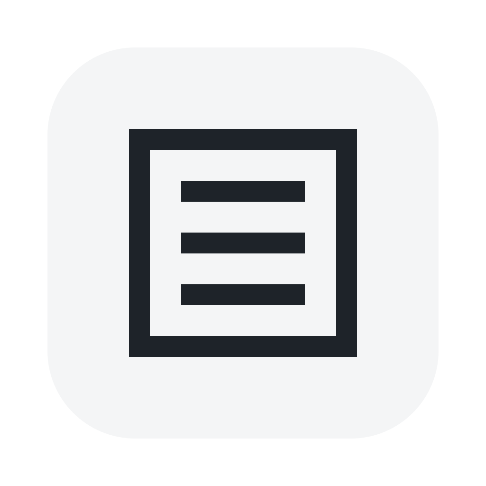
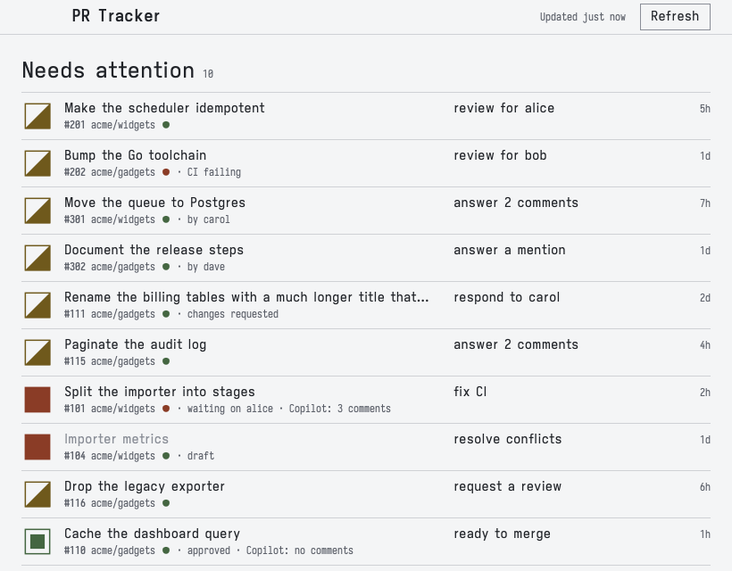
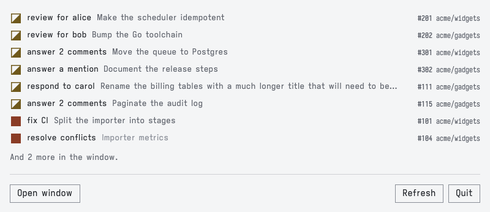

<div align="center">
  

  <h1>PR Tracker</h1>

  <p><b>macOS menu bar app: which GitHub pull requests need you, and what to do next.</b></p>

  <p>
    
    
    <a href="LICENSE"></a>
  </p>

  <picture>
    <source media="(prefers-color-scheme: dark)" srcset="docs/images/window-dark.png">
    
  </picture>
</div>

## Features

- **Next step per PR**: `answer 2 comments`, `waiting on bob for 3d`, `ready to merge`
- **Menu bar glyph**: most urgent status, dropdown of what needs you
- **Window**: needs attention first, then your PRs as stacks
- **Notifications**: review requests, reviews, failed CI, conflicts, mentions, replies
- Read-only, uses the `gh` token, 3 GraphQL points per poll

<div align="center">
  <picture>
    <source media="(prefers-color-scheme: dark)" srcset="docs/images/menu-dark.png">
    
  </picture>
</div>

## Install

Needs macOS 26+, Swift 6.2+, [`gh`](https://cli.github.com) logged in. No Xcode.

```sh
git clone https://github.com/j-hartshorn/pr-tracker.git
cd pr-tracker
./scripts/bundle.sh
open build/gh-tracker.app
```

## Develop

```sh
./scripts/check.sh     # tests
swift run Previews     # views as PNG in build/previews
```

Code layout: [docs/layout.md](docs/layout.md). Decisions: [docs/plans](docs/plans/v1-github-pr-tracker.md).

## Licence

[MIT](LICENSE). Iosevka fonts: [SIL OFL](docs/design-system/fonts/LICENSE-OFL.txt).
